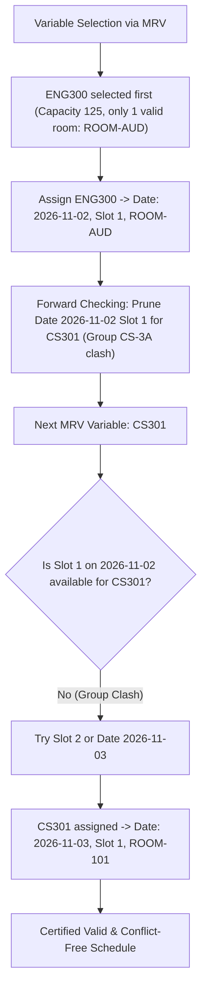

# AI-Based Exam Timetable Generator (PBL-I)
### Intelligent Constraint Satisfaction Scheduling Engine with Backtracking, Heuristics & Soft Optimization

[](https://www.python.org/)
[](https://fastapi.tiangolo.com/)
[](https://react.dev/)
[](https://www.typescriptlang.org/)
[](https://tailwindcss.com/)
[](https://docs.pytest.org/)

---

## 1. Executive Summary & Problem Statement

Scheduling academic examinations across multiple engineering departments, student cohorts, shared electives, examination rooms, and date-slot intervals is an **NP-complete combinatorial optimization problem**.

Traditional manual or randomized scheduling frequently results in:
- **Direct Student Clashes:** A student cohort or individual is scheduled for multiple examinations simultaneously.
- **Shared-Student Elective Clashes:** Students taking inter-departmental electives (e.g. AI and Computer Science cohorts sharing an elective course) face overlapping schedules.
- **Room Collisions & Capacity Violations:** Two examinations assigned to the same hall in the same time slot, or a course with 125 students placed in an 80-seat classroom.
- **Student Fatigue & Uneven Load:** Back-to-back testing without rest gaps or excessive concentration of exams on consecutive days.

This project implements an **Autonomous Constraint Satisfaction Problem (CSP)** engine that guarantees conflict-free examination schedules whenever a feasible assignment exists, records real algorithmic decision events for viva defendability, and optimizes schedules using soft-constraint branch-and-bound heuristics.

---

## 2. Technology Stack

- **Backend AI Engine & REST API:**
  - **Python 3.9+ / 3.11+**
  - **FastAPI** for asynchronous RESTful service endpoints
  - **Pydantic v2** for schema validation and serialization
  - **SQLAlchemy 2.0 & SQLite** for local database persistence
  - **Pytest** for deterministic test-driven verification
- **Frontend Academic Administration Dashboard:**
  - **React 18 + Vite** (High-performance build tool)
  - **TypeScript** (Strict type safety)
  - **Tailwind CSS** (Clean, accessible academic dashboard design)
  - **Lucide React** (Consistent iconography)
  - **Recharts** (Interactive data visualization for room utilization and exam load)

---

## 3. Mathematical & Algorithmic Formulation (CSP)

The examination scheduling challenge is formally modeled as a **Constraint Satisfaction Problem (CSP)** defined by the triple $\langle X, D, C \rangle$:

### A. Variables ($X$)
Each required examination $e_i \in X$ is a variable to be scheduled:
$$X = \{ e_1, e_2, \dots, e_n \}$$
Where each examination $e_i$ is parameterized by:
- Subject Code & Name
- Student Headcount $S(e_i)$
- Enrolled Student Groups $G(e_i) \subseteq \{ g_1, \dots, g_m \}$
- Required Room Type (e.g. "Standard", "Lab", "Auditorium")
- Allowed Dates and Allowed Time Slots

### B. Domains ($D$)
For each examination $e_i$, its domain $D(e_i)$ comprises all conceivable assignment triples:
$$v = \langle \text{date}, \text{slot\_id}, \text{room\_id} \rangle \in \mathcal{T} \times \mathcal{S} \times \mathcal{R}$$
Before search begins, **Unary Constraint Filtering** prunes values where:
- $\text{Capacity}(room) < S(e_i)$
- $\text{RoomType}(room) \ne \text{RequiredType}(e_i)$
- $\langle \text{date}, \text{slot\_id} \rangle \in \text{UnavailableSlots}(room)$
- Date or slot is outside $e_i$'s permissible calendar window

### C. Hard Constraints ($C_{\text{hard}}$) — Must Be Satisfied (Zero Tolerance)
1. **Student Group Conflict:**
   No student cohort can sit for more than one examination at the same date and slot:
   $$\forall e_i, e_j (i \ne j): (date(e_i) = date(e_j) \land slot(e_i) = slot(e_j)) \implies G(e_i) \cap G(e_j) = \emptyset$$
2. **Shared-Student Elective Conflict:**
   If groups $g_a$ and $g_b$ share students ($\langle g_a, g_b \rangle \in \text{SharedConflicts}$), examinations enrolled by $g_a$ and $g_b$ cannot coincide:
   $$g_a \in G(e_i) \land g_b \in G(e_j) \land \langle g_a, g_b \rangle \in \text{SharedConflicts} \implies \langle date(e_i), slot(e_i) \rangle \ne \langle date(e_j), slot(e_j) \rangle$$
3. **Room Exclusivity (No Double-Booking):**
   A room cannot host two examinations at the same date and time slot:
   $$\forall e_i, e_j (i \ne j): \langle date(e_i), slot(e_i) \rangle = \langle date(e_j), slot(e_j) \rangle \implies room(e_i) \ne room(e_j)$$
4. **Room Seating Capacity:**
   $$\text{Capacity}(room(e_i)) \ge S(e_i)$$
5. **Room Specialization:**
   $$\text{RoomType}(room(e_i)) = \text{RequiredRoomType}(e_i)$$
6. **Fixed / Locked Assignments:**
   Any manually frozen assignment must remain unchanged.

### D. Soft Constraints ($C_{\text{soft}}$) & Objective Penalty Function
Once hard feasibility is established, schedule quality is evaluated by a weighted penalty function (lower penalty = better schedule):

$$\text{Total Penalty} = \sum_{k=1}^5 w_k \cdot P_k$$

Where:
- **$P_1$ (Consecutive Slots for Same Group):** Penalizes assigning examinations in slot $t$ and slot $t+1$ on the same day for cohort $g$ ($w_1 = 20.0$).
- **$P_2$ (Same-Day Multiple Exams):** Heavily penalizes scheduling $\ge 2$ examinations on the same date for cohort $g$ ($w_2 = 30.0$).
- **$P_3$ (Study Gap Deficit):** Penalizes examinations on consecutive calendar days when $|date_2 - date_1| < \text{PreferredGap}$ ($w_3 = 12.0$).
- **$P_4$ (Day Load Imbalance):** Penalizes variance in examination counts across days ($\sigma_{\text{day}} \cdot w_4$, $w_4 = 5.0$).
- **$P_5$ (Empty Seat Waste):** Penalizes placing small classes in oversized auditoriums:
  $$\frac{\text{Capacity}(room) - S(e_i)}{\text{Capacity}(room)} \cdot w_5 \quad (w_5 = 3.0)$$

---

## 4. Intelligent Search Heuristics & Propagation

### 1. Minimum Remaining Values (MRV) Variable Ordering
Rather than selecting variables arbitrarily, MRV chooses the unassigned examination with the **smallest remaining valid domain size**:
$$e^* = \arg\min_{e \in X_{\text{unassigned}}} |D(e)|$$
*Rationale:* "Fail-First Principle". If an examination has very few candidate slots/rooms (e.g. requires a 150-seat Auditorium or a specialized GPU Lab), schedule it first before other exams consume its only valid slots.

### 2. Degree Heuristic (Tie-Breaker)
If multiple examinations tie with the same minimum domain size, the Degree Heuristic selects the examination involved in the **largest number of constraints with other remaining unassigned examinations**:
$$\text{Degree}(e) = |\{ e' \in X_{\text{unassigned}} \setminus \{e\} : \text{SharesGroup}(e, e') \lor \text{SharesElective}(e, e') \}|$$
*Rationale:* Breaks ties deterministically by selecting the variable that exerts the most influence over the remaining search space.

### 3. Least Constraining Value (LCV) Value Ordering
For the chosen variable $e^*$, candidate assignments $\langle \text{date}, \text{slot}, \text{room} \rangle$ are sorted according to how few choices they eliminate from the domains of neighboring unassigned examinations:
$$v^* = \arg\min_{v \in D(e^*)} \sum_{e' \in X_{\text{unassigned}}} \left| \{ v' \in D(e') : \text{Inconsistent}(v, v') \} \right|$$
*Rationale:* "Succeed-First Principle". Tries the most flexible value first to maximize the likelihood of reaching a leaf node without backtracking.

### 4. Forward Checking (FC) Constraint Propagation
After assigning $e^* = v$, the engine immediately iterates over all remaining unassigned examinations $e' \in X_{\text{unassigned}}$ and prunes inconsistent values from their domains.
- If any unassigned examination has its domain reduced to **empty** ($|D(e')| = 0$), the engine detects an imminent dead-end immediately.
- It triggers an instant backtrack, restoring pruned values and reversing the tentative assignment without exploring subtrees doomed to fail.

---

## 5. Algorithmic Walkthrough & Backtracking Example (Viva Demonstration)

Consider two examinations:
1. `CS301` (Operating Systems) — 65 students, Group `CS-3A`.
2. `ENG300` (Professional Ethics) — 125 students, Combined Groups `CS-3A` and `CS-3B`.

Available Rooms:
- `ROOM-101`: Capacity 80
- `ROOM-AUD`: Capacity 150 (Auditorium)



### Backtracking Recovery Scenario
Suppose a user locks `CS301` into `ROOM-AUD` on `2026-11-02 Slot 1`.
1. The solver attempts to schedule `ENG300` (125 students).
2. Unary constraint check verifies: only `ROOM-AUD` has capacity $\ge 125$.
3. Binary constraint check checks: `ROOM-AUD` on `2026-11-02 Slot 1` is already occupied by `CS301`.
4. Domain of `ENG300` on that slot is wiped out.
5. Forward checking logs a `PRUNED / DOMAIN_WIPEOUT` event and triggers recursive backtracking to find alternative dates or reject the conflict with an informative diagnostic report.

---

## 6. System Architecture

```mermaid
graph TD
    subgraph Frontend["Frontend Client (React 18 + Vite + TypeScript)"]
        Dashboard["Dashboard View"]
        ExamsUI["Examinations CRUD"]
        GroupsUI["Student Cohorts CRUD"]
        RoomsUI["Rooms & Capacity CRUD"]
        ConfigUI["Scheduling Config & Sliders"]
        GenUI["Timetable Generator & Progress"]
        ViewerUI["Multi-view Timetable Viewer (Grid/Table/Room/Group)"]
        AuditUI["Conflict Detection & Audit Report"]
        ExplainUI["AI Viva Explainability & Analytics"]
    end

    subgraph BackendAPI["Backend REST API (FastAPI)"]
        RouterDash["/api/dashboard"]
        RouterExams["/api/exams"]
        RouterGroups["/api/groups"]
        RouterRooms["/api/rooms"]
        RouterSlots["/api/slots"]
        RouterConfig["/api/config"]
        RouterTT["/api/timetables"]
        RouterDemo["/api/demo/reset"]
        RouterImport["/api/import/*"]
    end

    subgraph AIEngine["AI CSP Scheduling Engine"]
        Solver["CSPScheduler (Recursive Backtracking)"]
        Heuristics["MRV + Degree + LCV Heuristics"]
        Constraints["Hard Constraints & Forward Checking"]
        Optimizer["Branch & Bound Soft-Constraint Optimizer"]
        Validator["Independent TimetableValidator"]
        Explain["Decision Trace & Viva Generator"]
    end

    subgraph Storage["Persistent Storage"]
        DB[("SQLite Database (exam_timetable.db)")]
    end

    Frontend -->|HTTP / JSON| BackendAPI
    BackendAPI --> AIEngine
    BackendAPI --> Storage
    AIEngine --> Storage
```



---

## 7. Database Entity-Relationship Schema

The SQLite database (`exam_timetable.db`) consists of the following relational models managed by SQLAlchemy:

1. **`examinations`**: Course code, title, student count, group IDs (JSON), duration, allowed dates/slots, required room classification, preferred gap, priority, manual lock flags.
2. **`student_groups`**: Group code, name, enrollment count, shared elective conflicts list.
3. **`rooms`**: Room name, number, seating capacity, classification (Standard, Lab, Auditorium), equipment tags, unavailable maintenance slots.
4. **`time_slots`**: Slot name, start time, end time, sequence order, active state.
5. **`scheduling_configs`**: Period start/end dates, available dates array, soft constraint weights ($w_1 \dots w_5$), search duration budget, max backtracks.
6. **`timetables`**: Generated timetable header, status, hard audit validity boolean, soft penalty score, solver metrics, validation diagnostics report.
7. **`timetable_assignments`**: Individual assigned session: exam, date, slot, room, capacity, student count, cohort labels, freeze lock state.
8. **`timetable_explanations`**: Chronological decision log: step index, event type (`VARIABLE_SELECTION`, `ASSIGNMENT`, `PRUNED`, `BACKTRACK`), exam code, details, algorithmic rationale.

---

## 8. Installation & Setup Guide

### Prerequisites
- **Python 3.9+** (Python 3.9, 3.10, 3.11, or 3.12)
- **Node.js 18+** and **npm**

### Step 1: Clone or Navigate to Project Directory
```bash
cd "AI mini project"
```

### Step 2: Backend Virtual Environment & Dependencies
```bash
# Create Python virtual environment
python3 -m venv .venv

# Activate virtual environment
source .venv/bin/activate

# Install backend dependencies
pip install -r requirements.txt
```

### Step 3: Frontend Dependencies
```bash
cd frontend
npm install
cd ..
```

---

## 9. Running the Application

### Option A: Using Dedicated Startup Scripts

**Terminal 1 (Backend API):**
```bash
./start_backend.sh
```
*API will run at:* `http://127.0.0.1:8000`  
*Interactive Swagger API documentation:* `http://127.0.0.1:8000/docs`

**Terminal 2 (Frontend UI):**
```bash
./start_frontend.sh
```
*Web application will open at:* `http://localhost:5173`

---

### Option B: Manual Startup

**Backend:**
```bash
source .venv/bin/activate
export PYTHONPATH=.
python3 -m uvicorn backend.app.main:app --host 127.0.0.1 --port 8000 --reload
```

**Frontend:**
```bash
cd frontend
npm run dev
```

---

## 10. Demonstration & Viva Walkthrough Steps

1. **Open the Web Application:**
   Visit `http://localhost:5173`. Notice that the database automatically initializes with a curated academic demo dataset from an engineering college.
2. **Review Initial Dashboard:**
   Inspect the 6 top metric cards: Total Exams (12), Active Rooms (5), Cohorts (5), Exam Days (5), and Hard Violations (0).
3. **Inspect Problem Constraints:**
   - Go to **Student Groups**: Note that `CS-3A` and `AI-3` are marked with shared elective conflicts (Cloud Computing elective).
   - Go to **Examinations**: Note that `ENG300` has 125 students (can only fit in the 150-seat Auditorium), and `AI302` requires a specialized "Lab" room.
   - Go to **Rooms**: Room `201` is marked unavailable on `2026-11-03 Slot 2` for maintenance.
4. **Generate the Timetable:**
   - Click **Generate Timetable** in the navigation menu.
   - Enter a session title and click **Launch AI CSP Generator**.
   - Watch the animated progress states: Analytical pre-feasibility check $\to$ Unary reduction $\to$ MRV selection $\to$ Forward Checking $\to$ Branch-and-bound optimization.
   - A complete conflict-free schedule is generated in $< 0.1$ seconds with 0 hard violations!
5. **Explore Multi-View Timetable Viewer:**
   - **Grid Matrix View:** Visual matrix of examination days $\times$ daily time slots.
   - **Table View:** Searchable list with enrollment counts and hall allocations.
   - **Room-wise View:** See how halls and labs are utilized across the week.
   - **Cohort-wise View:** Inspect schedules batch-by-batch to verify exam spacing.
6. **Demonstrate Manual Editing & Independent Revalidation:**
   - In the Timetable Viewer, click any examination card (e.g. `CS301`).
   - Intentionally change its date, slot, and room to clash with another examination in the same hall.
   - Click **Update & Audit**.
   - Notice that the system **instantly flags a hard collision**! The header changes to "HARD CONFLICTS DETECTED", and the Conflict Audit page displays the exact collision with corrective advice.
7. **Demonstrate AI Repair:**
   - Click **AI Repair Schedule**.
   - The CSP solver locks unaffected assignments and re-solves remaining variables to re-establish a certified valid schedule.
8. **Inspect Viva Analytics & AI Explanations:**
   - Navigate to **AI Explanations & Stats**.
   - Review the chronological decision log detailing why examinations were chosen by MRV and why halls were ordered by LCV.
   - Review the Recharts charts showing examinations per day, room capacity utilization, and soft penalty distribution.

---

## 11. Automated Test Suite

The project includes an extensive test suite covering the CSP solver, heuristics, edge cases, infeasibility detection, independent validation, and API endpoints.

To run all automated tests:
```bash
./run_tests.sh
```
Or directly with pytest:
```bash
source .venv/bin/activate
export PYTHONPATH=.
pytest backend/tests/ -v
```

### Test Coverage Summary:
- `test_small_dataset_produces_valid_timetable`: CSP base feasibility.
- `test_shared_group_exams_never_overlap`: Verification that overlapping cohort exams are prohibited.
- `test_room_clash_prevention`: Room double-booking prohibition.
- `test_insufficient_room_capacity_rejected`: Rejection of rooms smaller than class enrollment.
- `test_unavailable_room_slot_respected`: Adherence to room maintenance blackouts.
- `test_backtracking_recovery`: Backtracking resolution when greedy choices cause dead ends.
- `test_independent_validator_detects_conflicts`: Independent auditor detection of injected collisions.
- `test_soft_constraint_penalty_calculation`: Verification of penalty scoring formula.
- `test_shared_student_cross_group_conflict`: Cross-branch elective conflict handling.
- `test_multi_day_multi_room_complex_schedule`: Multi-day, multi-lab scheduling with 8+ courses.
- `test_api_health`: REST API health probe.
- `test_demo_data_loaded`: Seed dataset integrity.
- `test_generate_timetable_success`: End-to-end generation endpoint.
- `test_manual_edit_and_revalidation`: Revalidation upon manual edit.
- `test_repair_timetable`: AI repair preserving locked assignments.
- `test_timetable_csv_export`: CSV export format compliance.

---

## 12. Known Limitations & Future Work

- **Multi-Room Splitting:** The current implementation schedules each examination into a single contiguous room of sufficient capacity. If a combined batch exceeds the largest available auditorium, the problem is analytically rejected rather than split across multiple halls. Future versions can incorporate multi-room co-allocation.
- **Invigilator / Faculty Allocation:** The current problem formulation focuses on examinations, student cohorts, rooms, and time slots. Future iterations can add faculty invigilation assignments as a secondary CSP stage.
